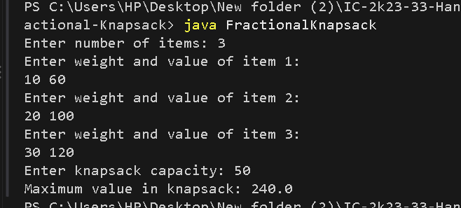

# Fractional Knapsack

## Problem Statement

Given a set of items, where each item has a weight and a value, and a knapsack with a limited capacity, maximize the total value of items placed in the knapsack.

In the Fractional Knapsack problem, items can be divided into fractions. The objective is to select items or fractions of items to obtain the maximum possible value without exceeding the knapsack capacity.

## Algorithm / Approach

The problem is solved using the Greedy Method.

1. Calculate the value-to-weight ratio for each item.
2. Sort the items in decreasing order of their value-to-weight ratio.
3. Select the item with the highest ratio first.
4. If the complete item fits, add its value and reduce the remaining capacity.
5. Otherwise, take the fraction that fits into the remaining capacity.
6. Continue until the knapsack is full.

## Pseudocode

```text
FractionalKnapsack(items, capacity):

    Sort items by decreasing value/weight ratio
    totalValue = 0

    For each item in sorted items:

        If capacity == 0:
            Break

        If item.weight <= capacity:
            totalValue = totalValue + item.value
            capacity = capacity - item.weight

        Else:
            totalValue = totalValue + item.ratio * capacity
            capacity = 0

    Return totalValue
```

## Time and Space Complexity Analysis

| Operation | Complexity |
|---|---|
| Calculate ratios | O(n) |
| Sort items | O(n log n) |
| Select items | O(n) |
| **Overall Time Complexity** | **O(n log n)** |
| **Space Complexity** | **O(n)** |

## Sample Input

```text
Enter number of items: 3
Enter weight and value of item 1:
10 60
Enter weight and value of item 2:
20 100
Enter weight and value of item 3:
30 120
Enter knapsack capacity: 50
```

## Sample Output

```text
Maximum value in knapsack: 240.0
```

### Screenshots / Graphs

The program was compiled and executed successfully using Java.



## Experimental Results

For three items with weights 10, 20, and 30 and values 60, 100, and 120, the knapsack capacity is 50.

The algorithm selects the first two complete items and 20 units of the third item.

The maximum value obtained is 240.

## Learning Outcomes

- Learned how to apply the Greedy Method.
- Understood the importance of the value-to-weight ratio.
- Learned how to sort items based on a custom comparison.
- Understood the difference between Fractional Knapsack and 0/1 Knapsack.
- Analyzed the time and space complexity of a greedy algorithm.