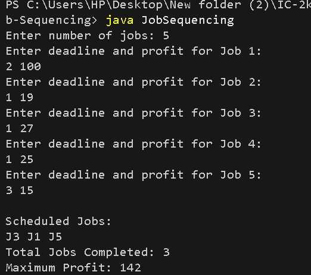

# Job Sequencing with Deadlines

## Problem Statement
Given a set of jobs, each with a deadline and profit, schedule the jobs to maximize total profit. Each job takes one unit of time, and a job must be completed before or on its deadline.

## Algorithm / Approach
1. Sort all jobs in descending order of profit.
2. Find the maximum deadline among all jobs.
3. Create time slots from 1 to the maximum deadline.
4. For each job, search for the latest available slot before or on its deadline.
5. If a slot is available, schedule the job and add its profit.
6. Display the scheduled jobs and maximum profit.

## Pseudocode

```text
JOB-SEQUENCING(jobs):
    Sort jobs by decreasing profit
    maxDeadline = maximum deadline
    Create empty slots from 1 to maxDeadline
    totalProfit = 0

    for each job in jobs:
        for slot = job.deadline down to 1:
            if slot is empty:
                schedule job in slot
                totalProfit += job.profit
                break

    Display scheduled jobs
    Display totalProfit
```

## Time and Space Complexity
- **Time Complexity:** O(n log n + n × D), where D is the maximum deadline.
- **Space Complexity:** O(D), where D is the maximum deadline.

## Sample Input

```text
5
2 100
1 19
2 27
1 25
3 15
```

## Sample Output

```text
Scheduled Jobs:
J3 J1 J5
Total Jobs Completed: 3
Maximum Profit: 142
```

## Screenshots / Graphs

The program was compiled and executed successfully using Java.



## Experimental Results
The greedy approach schedules jobs in descending order of profit and places each job in the latest available slot before its deadline. For the sample input, the maximum profit obtained is 142.

## Learning Outcomes
- Understanding the Greedy Method.
- Learning how to schedule jobs based on deadlines and profits.
- Applying sorting and slot allocation to maximize profit.
