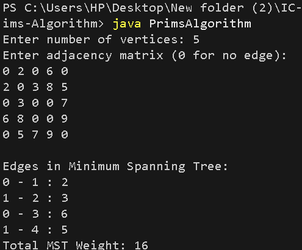

# Prim's Algorithm (Minimum Spanning Tree)

## Problem Statement
Given a connected, undirected, weighted graph, find a Minimum Spanning Tree (MST) that connects all vertices with the minimum possible total edge weight.

## Algorithm / Approach
1. Start from vertex 0.
2. Initialize the key value of vertex 0 as 0 and all other vertices as infinity.
3. Select the vertex with the minimum key value that is not yet included in the MST.
4. Include the selected vertex in the MST.
5. Update the key values of its adjacent vertices if a smaller edge weight is found.
6. Repeat until all vertices are included.
7. Display the MST edges and total weight.

## Pseudocode

```text
PRIM(graph, vertices):
    Initialize key[] = infinity
    Initialize mstSet[] = false
    key[0] = 0

    Repeat vertices - 1 times:
        u = vertex with minimum key not in MST
        Add u to MST

        for each adjacent vertex v of u:
            if v is not in MST and graph[u][v] < key[v]:
                parent[v] = u
                key[v] = graph[u][v]

    Display MST edges
    Display total weight
```

## Time and Space Complexity
- **Time Complexity:** O(V²), where V is the number of vertices.
- **Space Complexity:** O(V²), for the adjacency matrix.

## Sample Input

```text
5
0 2 0 6 0
2 0 3 8 5
0 3 0 0 7
6 8 0 0 9
0 5 7 9 0
```

## Sample Output

```text
Edges in Minimum Spanning Tree:
0 - 1 : 2
1 - 2 : 3
0 - 3 : 6
1 - 4 : 5
Total MST Weight: 16
```

## Screenshots / Graphs

The program was compiled and executed successfully using Java.



## Experimental Results
The algorithm selects the minimum-weight edge that connects a new vertex to the growing MST. For the sample graph, the total MST weight is 16.

## Learning Outcomes
- Understanding Minimum Spanning Trees.
- Learning the Greedy Method.
- Applying Prim's Algorithm to find a minimum-cost spanning tree.
