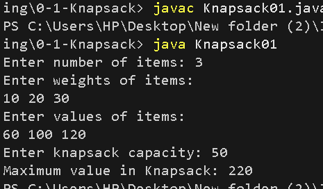

# 0/1 Knapsack Problem

## Problem Statement
Given a set of items, each having a weight and a value, find the maximum value that can be placed in a knapsack of limited capacity. Each item can either be selected or not selected.

## Algorithm / Approach
The problem is solved using Dynamic Programming. A 2D DP table stores the maximum value achievable using the first `i` items and capacity `w`.

For each item:
- Include the item if its weight does not exceed the current capacity.
- Exclude the item.
- Choose the option that gives the maximum value.

## Pseudocode
```text
KNAPSACK(weights, values, capacity, n):
    create dp[n+1][capacity+1]

    for i = 1 to n:
        for w = 0 to capacity:
            if weights[i-1] <= w:
                dp[i][w] = max(
                    values[i-1] + dp[i-1][w-weights[i-1]],
                    dp[i-1][w]
                )
            else:
                dp[i][w] = dp[i-1][w]

    return dp[n][capacity]
```

## Time and Space Complexity
- **Time Complexity:** O(n × capacity)
- **Space Complexity:** O(n × capacity)

## Sample Input
```text
Number of items: 3
Weights: 10 20 30
Values: 60 100 120
Knapsack capacity: 50
```

## Sample Output
```text
Maximum value in Knapsack: 220
```

## Screenshots


## Experimental Results
The algorithm calculates the maximum achievable value while ensuring that the total weight does not exceed the knapsack capacity.

## Learning Outcomes
- Understood the 0/1 Knapsack problem.
- Learned to solve optimization problems using Dynamic Programming.
- Practiced building and using a 2D DP table.