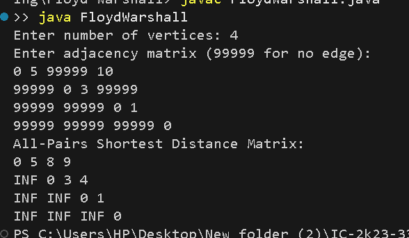

# Floyd-Warshall Algorithm

## Problem Statement
Find the shortest distances between every pair of vertices in a weighted graph.

## Algorithm / Approach
The Floyd-Warshall algorithm uses Dynamic Programming. Each vertex is considered as an intermediate vertex, and the distance matrix is updated if a shorter path is found through that vertex.

## Pseudocode
```text
FLOYD-WARSHALL(graph, n):
    dist = graph

    for k = 0 to n-1:
        for i = 0 to n-1:
            for j = 0 to n-1:
                if dist[i][k] + dist[k][j] < dist[i][j]:
                    dist[i][j] = dist[i][k] + dist[k][j]

    return dist
```

## Time and Space Complexity
- **Time Complexity:** O(V³)
- **Space Complexity:** O(V²)

## Sample Output
```text
All-Pairs Shortest Distance Matrix:
0 5 8 9
INF 0 3 4
INF INF 0 1
INF INF INF 0
```

## Screenshots


## Experimental Results
The algorithm computes the shortest distance between all pairs of vertices, including paths that use intermediate vertices.

## Learning Outcomes
- Understood the all-pairs shortest path problem.
- Learned the Floyd-Warshall Dynamic Programming technique.
- Practiced updating a distance matrix using intermediate vertices.