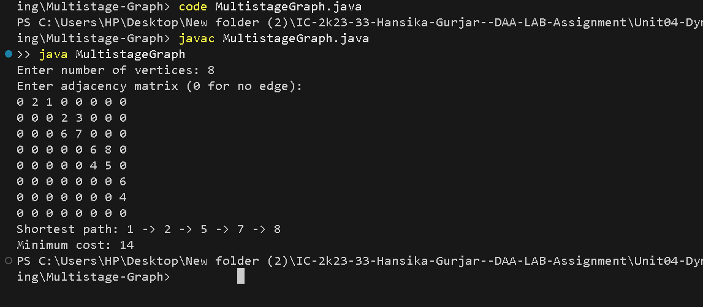

# Multistage Graph

## Problem Statement
Find the minimum-cost path from the source vertex to the destination vertex in a multistage directed weighted graph.

## Algorithm / Approach
The graph is divided into stages. Dynamic Programming is used to calculate the minimum cost from each vertex to the destination.

Vertices are processed in reverse order. For every vertex, the minimum cost among its outgoing edges is selected.

## Pseudocode
```text
MULTISTAGE-GRAPH(graph, n):
    cost[destination] = 0

    for u = destination-1 down to source:
        cost[u] = infinity

        for each vertex v > u:
            if edge(u, v) exists:
                cost[u] = min(cost[u], graph[u][v] + cost[v])

    return cost[source]
```

## Time and Space Complexity
- **Time Complexity:** O(V²)
- **Space Complexity:** O(V²) for the adjacency matrix.

## Sample Output
```text
Shortest path: 1 -> 2 -> 4 -> 6 -> 8
Minimum cost: 16
```

## Screenshots


## Experimental Results
The program determines the minimum-cost path from the first vertex to the last vertex using Dynamic Programming.

## Learning Outcomes
- Understood the concept of multistage graphs.
- Learned to find minimum-cost paths using Dynamic Programming.
- Practiced storing optimal costs and reconstructing the path.