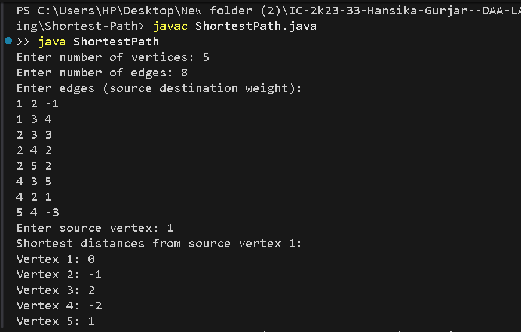

# Shortest Path — Bellman-Ford Algorithm

## Problem Statement
Find the shortest distance from a source vertex to all other vertices in a weighted directed graph. The algorithm can handle negative edge weights but not negative weight cycles.

## Algorithm / Approach
The Bellman-Ford algorithm initializes the source distance to zero and all other distances to infinity.

It relaxes all edges `V-1` times to find the shortest distances. It then checks for a negative weight cycle.

## Pseudocode
```text id="1jsa5e"
BELLMAN-FORD(edges, V, source):
    distance[source] = 0
    all other distances = infinity

    repeat V-1 times:
        for each edge (u, v, weight):
            if distance[u] + weight < distance[v]:
                distance[v] = distance[u] + weight

    check all edges for negative weight cycle
    return distance
```

## Time and Space Complexity
- **Time Complexity:** O(V × E)
- **Space Complexity:** O(V + E)

## Sample Output
```text id="l5rb09"
Shortest distances from source vertex 1:
Vertex 1: 0
Vertex 2: -1
Vertex 3: 2
Vertex 4: -2
Vertex 5: 1
```

## Screenshots


## Experimental Results
The algorithm calculates shortest distances from the selected source vertex and detects negative weight cycles.

## Learning Outcomes
- Understood the single-source shortest path problem.
- Learned edge relaxation.
- Practiced handling negative edge weights and detecting negative weight cycles.