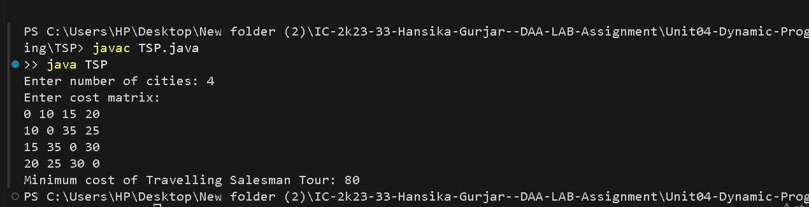

# Travelling Salesman Problem (TSP)

## Problem Statement
Find the minimum-cost tour in which a salesperson visits every city exactly once and returns to the starting city.

## Algorithm / Approach
The problem is solved using Dynamic Programming with Bitmasking.

A bitmask represents the set of visited cities. The DP state `dp[mask][current]` stores the minimum cost of visiting all remaining cities when the current city is `current` and the visited set is `mask`.

## Pseudocode
```text id="k9n4lx"
TSP(mask, current):
    if all cities are visited:
        return cost[current][start]

    if dp[mask][current] is computed:
        return dp[mask][current]

    minimumCost = infinity

    for each unvisited city next:
        newCost = cost[current][next]
                  + TSP(mask with next visited, next)

        minimumCost = min(minimumCost, newCost)

    dp[mask][current] = minimumCost
    return minimumCost
```

## Time and Space Complexity
- **Time Complexity:** O(n² × 2ⁿ)
- **Space Complexity:** O(n × 2ⁿ)

## Sample Input
```text id="l2xv5g"
4
0 10 15 20
10 0 35 25
15 35 0 30
20 25 30 0
```

## Sample Output
```text id="1k8h6y"
Minimum cost of Travelling Salesman Tour: 80
```

## Screenshots


## Experimental Results
The algorithm calculates the minimum tour cost by storing results for previously visited city combinations.

## Learning Outcomes
- Understood the Travelling Salesman Problem.
- Learned Dynamic Programming with Bitmasking.
- Practiced memoizing states to avoid repeated calculations.