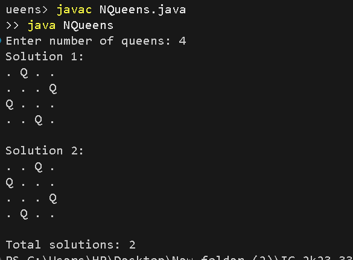

# N-Queens Problem

## Problem Statement
Place N queens on an N × N chessboard such that no two queens attack each other. No two queens should share the same row, column, or diagonal.

## Algorithm / Approach
The N-Queens problem is solved using Backtracking.

The algorithm places one queen in each row. It checks whether the position is safe. If a safe position is found, it places the queen and moves to the next row. If no valid position is available, it backtracks and tries another position.

## Pseudocode
```text id="7nbv3d"
NQUEENS(row):
    if row == N:
        print solution
        return

    for col = 0 to N-1:
        if IS-SAFE(row, col):
            board[row] = col
            NQUEENS(row + 1)
            board[row] = -1
```

## Time and Space Complexity
- **Time Complexity:** O(N!)
- **Space Complexity:** O(N), excluding the output storage.

## Sample Input
```text id="x9qf4b"
4
```

## Sample Output
```text id="u4y5ma"
Total solutions: 2
```

## Screenshots


## Experimental Results
For N = 4, the program finds two valid arrangements of queens on the chessboard.

## Learning Outcomes
- Understood the Backtracking technique.
- Learned to check row, column, and diagonal constraints.
- Practiced generating valid arrangements using recursion.