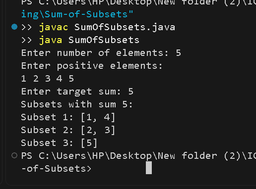

# Sum of Subsets using Backtracking

## Problem Statement
Given a set of positive integers and a target sum, find all subsets whose elements add up to the target sum.

## Algorithm / Approach
The Sum of Subsets problem is solved using the backtracking technique.

For each element, the algorithm explores two choices:
1. Include the element in the current subset.
2. Exclude the element from the current subset.

If the current sum equals the target, the subset is printed. If the current sum exceeds the target, that branch is stopped.

## Pseudocode
```text
SUM_OF_SUBSETS(index, currentSum, subset):
    if currentSum == target:
        print subset
        return

    if index == n or currentSum > target:
        return

    Include weights[index] in subset
    SUM_OF_SUBSETS(index + 1, currentSum + weights[index], subset)

    Remove weights[index] from subset

    Exclude weights[index]
    SUM_OF_SUBSETS(index + 1, currentSum, subset)
```

## Time and Space Complexity
- **Time Complexity:** O(2^n) in the worst case
- **Auxiliary Space Complexity:** O(n) for the recursion stack and current subset

## Sample Input
```text
Number of elements: 5
Elements: 1 2 3 4 5
Target sum: 5
```

## Sample Output
```text
Subsets with sum 5:
[1, 4]
[2, 3]
[5]
```

## Output Screenshot


## Learning Outcomes
- Understand the backtracking technique.
- Explore include and exclude choices recursively.
- Use pruning to stop unnecessary recursive branches.
- Analyze the time and space complexity of a recursive algorithm.
