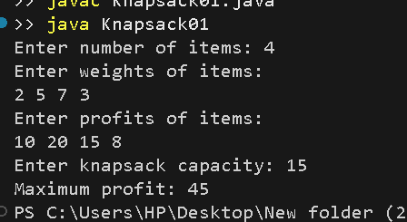

# 0/1 Knapsack using Dynamic Programming

## Problem Statement
Given a set of items, each with a weight and profit, find the maximum profit that can be obtained without exceeding the knapsack capacity. Each item can either be selected completely or excluded.

## Algorithm / Approach
The 0/1 Knapsack problem is solved using Dynamic Programming.

1. Create a DP table of size `(n+1) × (W+1)`.
2. Initialize the table with zero values.
3. For each item, check whether its weight is within the current capacity.
4. If it fits, choose the maximum of including or excluding the item.
5. If it does not fit, copy the result from the previous row.
6. The final answer is stored in `dp[n][W]`.

## Pseudocode
```text
KNAPSACK(weights, profits, n, W):
    Create dp[n+1][W+1]

    for i = 1 to n:
        for w = 0 to W:
            if weights[i-1] <= w:
                dp[i][w] = max(
                    profits[i-1] + dp[i-1][w-weights[i-1]],
                    dp[i-1][w]
                )
            else:
                dp[i][w] = dp[i-1][w]

    return dp[n][W]
```

## Time and Space Complexity
- **Time Complexity:** O(n × W)
- **Space Complexity:** O(n × W)

Where `n` is the number of items and `W` is the knapsack capacity.

## Sample Input
```text
Number of items: 4
Weights: 2 5 7 3
Profits: 10 20 15 8
Knapsack capacity: 15
```

## Sample Output
```text
Maximum profit: 45
```

## Output Screenshot


## Learning Outcomes
- Understand the Dynamic Programming approach.
- Learn to construct and use a DP table.
- Solve optimization problems using optimal substructure.
- Analyze time and space complexity.
