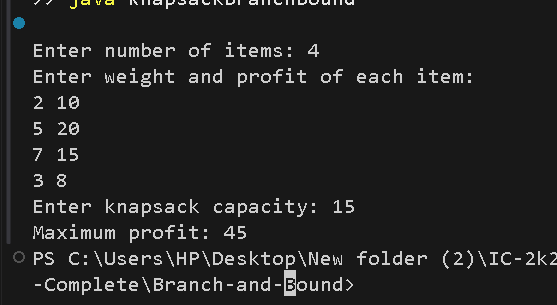

# 0/1 Knapsack using Branch and Bound

## Problem Statement
Given a set of items, each having a weight and profit, find the maximum profit that can be obtained by selecting items without exceeding the given knapsack capacity. Each item can either be selected completely or not selected.

## Algorithm / Approach
The Branch and Bound technique is used to solve the 0/1 Knapsack problem.

1. Calculate the profit-to-weight ratio of each item.
2. Sort items in descending order of their ratios.
3. Create a root node and calculate its upper bound.
4. Explore two choices: include or exclude the next item.
5. Calculate the bound for each node.
6. Ignore nodes whose bound cannot improve the current maximum profit.
7. Return the maximum profit obtained.

## Pseudocode
```text
BRANCH_AND_BOUND(items, capacity):
    Sort items by profit/weight ratio
    Create a priority queue
    Insert root node into queue
    maxProfit = 0

    while queue is not empty:
        current = remove node with highest bound

        if current.bound <= maxProfit:
            continue

        Create include node
        if include node is within capacity:
            update maxProfit
            calculate its bound
            add it if its bound is promising

        Create exclude node
        calculate its bound
        add it if its bound is promising

    return maxProfit
```

## Time and Space Complexity
- **Worst-case Time Complexity:** O(2^n), excluding sorting and priority-queue overhead
- **Worst-case Space Complexity:** O(2^n)

## Sample Input
```text
Number of items: 4
Weight and profit:
2 10
5 20
7 15
3 8
Knapsack capacity: 15
```

## Sample Output
```text
Maximum profit: 45
```

## Output Screenshot


## Learning Outcomes
- Understand the Branch and Bound technique.
- Learn how upper bounds help eliminate unpromising solutions.
- Apply a priority queue to explore promising nodes.
- Understand how Branch and Bound solves combinatorial optimization problems.
