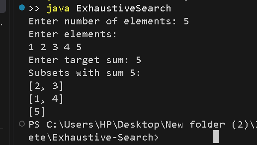

# Exhaustive Search – Subset Sum Problem

## Problem Statement
Given a set of integers and a target sum, find all possible subsets whose elements add up to the target sum using the exhaustive search technique.

## Algorithm / Approach
Exhaustive Search checks every possible subset of the given array.

1. Generate all possible subsets using bit masking.
2. Calculate the sum of each subset.
3. Compare the sum with the target value.
4. Print all subsets whose sum equals the target.
5. If no subset matches, display an appropriate message.

## Pseudocode
```text
EXHAUSTIVE_SEARCH(arr, target):
    n = length(arr)
    found = false

    for mask = 0 to 2^n - 1:
        sum = 0
        subset = empty

        for i = 0 to n - 1:
            if bit i is set in mask:
                add arr[i] to subset
                sum = sum + arr[i]

        if sum == target:
            print subset
            found = true

    if found == false:
        print "No subset found"
```

## Time and Space Complexity
- **Time Complexity:** O(n × 2^n)
- **Auxiliary Space Complexity:** O(n)

## Sample Input
```text
Enter number of elements: 5
Enter elements:
1 2 3 4 5
Enter target sum: 5
```

## Sample Output
```text
Subsets with sum 5:
[1, 4]
[2, 3]
[5]
```

## Output Screenshot


## Learning Outcomes
- Understand the exhaustive search technique.
- Generate all possible subsets using bit manipulation.
- Learn how to solve optimization and decision problems by checking all possibilities.
- Analyze exponential time complexity.
