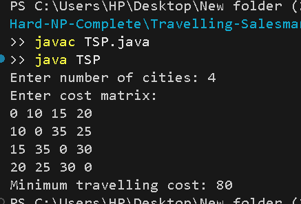

# Travelling Salesman Problem using Dynamic Programming

## Problem Statement
The Travelling Salesman Problem (TSP) finds the minimum-cost route that visits every city exactly once and returns to the starting city.

## Algorithm / Approach
The problem is solved using Dynamic Programming with the Bitmasking technique (Held-Karp algorithm).

1. Represent visited cities using a bitmask.
2. Initialize the starting city with cost zero.
3. Explore unvisited cities and update the minimum travel cost.
4. Store intermediate results in a DP table.
5. After visiting all cities, add the cost of returning to the starting city.
6. Return the minimum total travelling cost.

## Pseudocode
```text
TSP(graph, n):
    totalMasks = 2^n
    Create dp[totalMasks][n]
    Initialize dp with infinity
    dp[1][0] = 0

    for each mask:
        for each visited city u:
            for each unvisited city v:
                newMask = mask OR (1 << v)
                dp[newMask][v] = min(
                    dp[newMask][v],
                    dp[mask][u] + graph[u][v]
                )

    answer = minimum cost of visiting all cities
             and returning to city 0

    return answer
```

## Time and Space Complexity
- **Time Complexity:** O(n² × 2ⁿ)
- **Space Complexity:** O(n × 2ⁿ)

## Sample Input
```text
Number of cities: 4

Cost matrix:
0 10 15 20
10 0 35 25
15 35 0 30
20 25 30 0
```

## Sample Output
```text
Minimum travelling cost: 80
```

## Output Screenshot


## Learning Outcomes
- Understand the Travelling Salesman Problem.
- Apply Dynamic Programming with bitmasking.
- Learn the Held-Karp algorithm.
- Analyze exponential time and space complexity.
